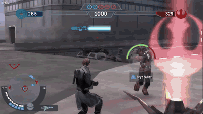

# swbes-recomp

Static recompilation of *Star Wars Battlefront: Elite Squadron* (PSP, EU, ULES-01214 v1.00) to native PC, built on [psprecomp](https://github.com/sp00nznet/psprecomp).

Battlefront's PSP outing, running natively on Windows: full matches in space and on the ground, at high resolution, with real mouse and keyboard or controller support.

I set out to slop up a quick recomp of Elite Squadron to make it more accessible, since the terrible PSP controls were driving me insane.

This isn't exactly Battlefront 3 or anything, but I hope it helps you experience a part of the Star Wars universe until an actual official port comes out.

It includes native mouse support for the menus, combat and so on, rebindable keys, dynamic glyphs for controllers and keyboard and mouse, uncapped frame rates and mod support.

I haven't managed to test every single aspect of the project personally, and all of it is written by AI. I fully understand if you don't want to support or play it because of that.

> [!NOTE]
> **Made with AI.** This port was written almost entirely by an AI model (Claude), directed by one person, and the reverse engineering is the AI's reading of the game.
>
> **Unofficial.** It has no relation to Lucasfilm, LucasArts, Disney, Sony, Rebellion or any other owner of Star Wars or this game, and none of them endorse it.
>
> **Some rough edges.** It plays, but expect the odd visual glitch, quirk or crash. Back up your saves, and please report what you find.

**Bring your own copy.** Releases and this repository contain no game assets. To play, you need your own copy of the game.

## What's new over the PSP

- **Mouse and keyboard, for real.** PC controls drive the game's actions directly instead of pretending to be a PSP pad. They cover infantry, starfighters, tanks, turrets and walkers, and the upgrade and hero offers.
- **Controllers.** Xbox, DualSense and DualShock 4 pads, with button prompts in your pad's own style.
- **Everything rebindable.** Press F1 > Controls to set a key and a pad button per action. It adds optional extras the PSP never had, such as toggle sprint, previous weapon and target hold.
- **Higher resolution.** The game renders above the PSP's 480x272 and runs uncapped or at a set frame rate. You also get texture filtering up to 16x anisotropic, and the colour filter can be turned off.
- **Widescreen and fullscreen.** On wider screens (up to 32:9) the 3D view widens and the HUD stays 16:9 in the middle. Alt+Enter switches to borderless fullscreen. Both are in Options.
- **Mods.** Replace disc files and textures, and dump textures to edit them. See `games/swbes/MODDING.md` (`docs` in releases).
- **Cheats tab** in the F1 menu.

## Playing
1. Download the latest release zip and extract it.
2. Put your Elite Squadron `.iso` (EU, ULES-01214) in its `game_data\` folder.
3. Run `swbes.exe`. The first start unpacks the disc and decrypts its EBOOT, which takes a minute. Saves, `settings.ini` and mods are kept in `game_data\`.

The exe isn't signed, so Windows may warn on first run: click **More info > Run anyway**. If something breaks, `swbes.log` beside the exe has the details; include it when [reporting an issue](https://github.com/Revgith/swbes-recomp/issues).

**Updating:** extract the new release over your old folder. Everything in `game_data\` is kept. The version is shown in the F1 menu, and `CHANGELOG.md` lists what changed.

## Building
1. Put your `.iso` (or its extracted files) in `game_data\`. The build decrypts its EBOOT into `game_data\eboot.elf` with `ebootdec`; a PPSSPP dump there is used instead if present.
2. Install Visual Studio (C/C++ workload) and CMake, then run `scripts\build.ps1`. It builds the recompiler, recompiles the EBOOT into C (`build\gen`), and builds `build\swbes.exe`.
3. Run `build\swbes.exe`; it finds `game_data\` beside it or one folder up. To publish a release or hotfix, see `RELEASING.md`.

## Movies
Video playback uses `ffmpeg.exe`, copied next to `swbes.exe` at build time. `scripts/build_ffmpeg.sh` (MSYS2 MinGW64) builds a minimal LGPL, H.264-only ffmpeg into `third_party/ffmpeg-min`, which the build prefers; otherwise any `ffmpeg` on PATH (or `-DSWBES_FFMPEG=...`) is used. Without one, movies are skipped.

## Controls and settings
Mouse and keyboard drive the game's actions directly. F1 opens the PC menu (settings, key binds, mods, cheats). The full action map is in `games/swbes/CONTROLS.md` and modding in `games/swbes/MODDING.md` (both in `docs` in releases).

## Development
The test scripts in `scripts\` (`quick.ps1`, `bench.ps1`, ...) and the `PSPRECOMP_*` / `SWBES_*` environment variables are debugging aids. Given a module path as its argument, `swbes.exe` loads it with the disc in `<its folder>\disc` instead of using `game_data`. See `docs/NOTES.md` for bring-up notes.

## Licence
This project's own code is under the [PolyForm Noncommercial 1.0.0](LICENSE) licence: free for any noncommercial use. `psprecomp/` is MIT. Bundled libraries are listed in [THIRD_PARTY.md](THIRD_PARTY.md).
